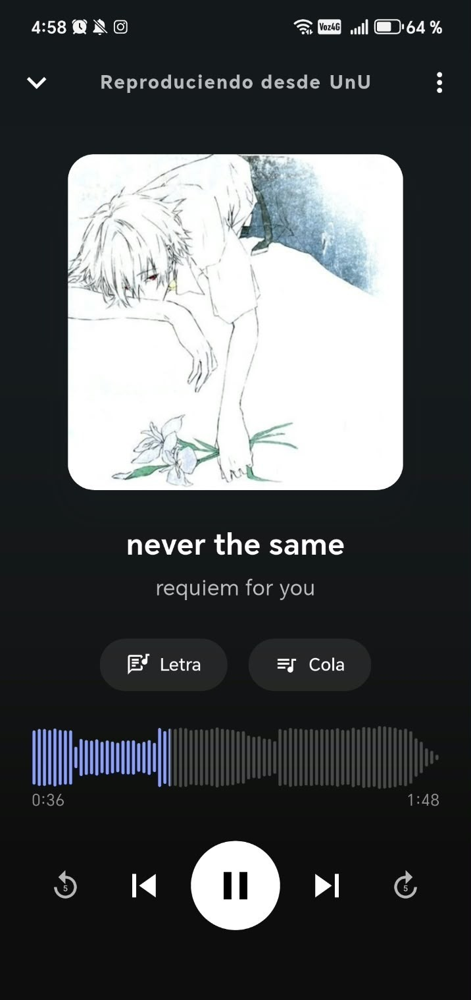
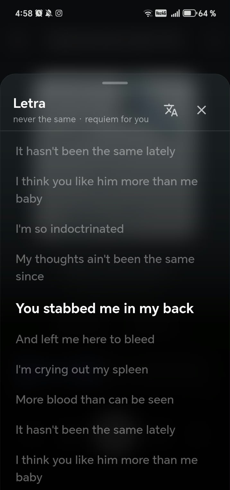
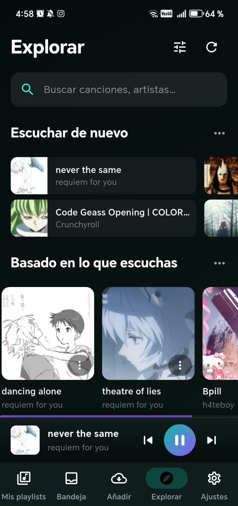
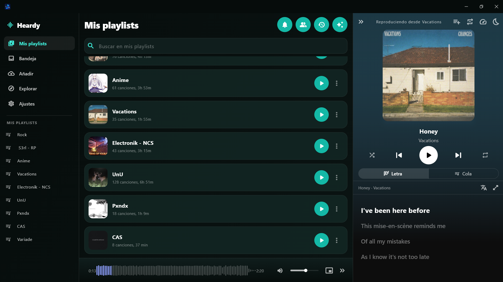

# Heardy

Heardy es un reproductor y biblioteca de música para Android y Windows. Trabaja sobre los archivos de audio que ya tenés en el dispositivo, los organiza en playlists, lee su metadata y los reproduce sin conexión. Además suma, de forma opcional, letras sincronizadas, estadísticas, cuenta con sincronización entre dispositivos, amigos, Explorar e importar desde un enlace; ninguna es necesaria para escuchar tu biblioteca.

Este repositorio contiene el **código fuente de la app** y publica las notas de cada versión como [Releases](../../releases). Los binarios se descargan únicamente desde el sitio web.

## Descargas

Siempre la última versión, desde **[vainastech.com/heardy](https://vainastech.com/heardy/#descargas)**:

- **Android**: `Heardy.apk`. Al instalar fuera de una tienda, Android pide permitir "orígenes desconocidos" para el navegador o el gestor de archivos.
- **Windows**: `Heardy-Setup.exe`. El instalador no está firmado con certificado, así que SmartScreen avisa de "editor desconocido" la primera vez: *Más información → Ejecutar de todas formas*.

Las releases de este repositorio llevan solo la etiqueta `vX.Y.Z` y las notas; los binarios ya no se adjuntan. Se construyen por GitHub Actions a partir de la etiqueta (ver `.github/workflows/release.yml`) y se suben a un almacenamiento propio desde el que los sirve el sitio.

## Capturas

<p>
  
  
  
</p>


## Qué hace

- **Biblioteca local**: una carpeta elegida una vez; escaneo incremental que reconoce archivos movidos o renombrados por el hash del audio; nada se borra solo.
- **Reproducción**: segundo plano con controles del sistema, letras sincronizadas (LRCLIB o, como fuente alternativa, NetEase Cloud Music) con traducción (MyMemory), cola reordenable, aleatorio, repetición, temporizador de apagado.
- **Escuchar sin descargar**: streaming desde Explorar o la búsqueda en línea, en Android y Windows; requiere cuenta.
- **Estadísticas** de escucha, con imagen para compartir.
- **Escritorio (Windows)**: interfaz de tres columnas con panel "Reproduciendo ahora".
- **Cuenta opcional**: sincroniza un índice de la biblioteca (títulos, playlists, historial), nunca el audio.
- **Importar desde un enlace (opcional)**: usa el servidor del proyecto y requiere una cuenta; el audio importado acaba como un archivo más en tu carpeta. Lo que importes es responsabilidad tuya: solo contenido sobre el que tengas derechos.

## Compilar desde el código fuente

Requisitos: Flutter estable (ver `environment` en `pubspec.yaml`), JDK 17 y Android SDK para el APK, Visual Studio con la carga de trabajo de C++ para Windows, y [Inno Setup 6](https://jrsoftware.org/isinfo.php) para el instalador.

```bash
flutter pub get
flutter gen-l10n
flutter run                      # Android conectado, o `-d windows`
flutter build apk --release      # APK (necesita tu propia firma, ver abajo)
flutter build windows --release  # build/windows/x64/runner/Release/
flutter analyze && flutter test
```

Instalador de Windows, tras `flutter build windows --release`:

```bash
ISCC.exe windows\installer\heardy.iss   # deja build\windows\installer\Heardy-Setup.exe
```

**Firma de Android**: `android/app/build.gradle` espera un keystore en `heardy-release-key.jks` (raíz del repo) y un `android/keystore.properties` con `storePassword`, `keyPassword` y `keyAlias`. Ninguno de los dos se versiona; para pruebas propias genera tu keystore con `keytool`.

**Servidor**: la app apunta por defecto al servidor oficial del proyecto. Para otro, compilar con `--dart-define=HEARDY_OFFICIAL_SERVER_URL=...`. Las funciones con cuenta usan el proyecto de Firebase del proyecto (`android/app/google-services.json`); si compilas tu propia variante, sustituye esa configuración por la tuya.

## Créditos

Heardy es publicado por **Vainastech**. Se apoya en software libre; gracias a sus autores:

- [NewPipeExtractor](https://github.com/TeamNewPipe/NewPipeExtractor) y [NewPipe](https://github.com/TeamNewPipe/NewPipe) (TeamNewPipe), GPL-3.0-or-later: resolución de enlaces en Android; algunos archivos del plugin `packages/heardy_yt_stream` derivan de NewPipe y conservan su aviso.
- [yt-dlp](https://github.com/yt-dlp/yt-dlp), Unlicense: resolución de enlaces en Windows (binario incluido y autoactualizable).
- [FFmpeg](https://ffmpeg.org/) (compilación LGPL de BtbN), LGPL-2.1-or-later: onda del reproductor en Windows; viaja con su `LICENSE.txt`.
- [media_kit](https://github.com/media-kit/media-kit) y libmpv: reproducción de audio en Windows.
- [cryptography](https://pub.dev/packages/cryptography): cifrado de la sincronización por Wi-Fi.
- OkHttp, RxJava y nanojson (Apache-2.0) en el plugin de Android; [LRCLIB](https://lrclib.net/) para las letras.
- [Flutter](https://flutter.dev/) y los paquetes de Dart/Flutter listados en `pubspec.lock`, cada uno bajo su licencia (BSD-3-Clause, MIT, Apache-2.0...). Las licencias también se ven dentro de la app, en la página de licencias.

El detalle y las modificaciones están en [`NOTICE.md`](NOTICE.md). Heardy no está afiliado ni respaldado por ninguno de estos proyectos.

## Licencia

Heardy se distribuye bajo la **GNU General Public License v3.0**; ver [`LICENSE`](LICENSE). Incluye componentes de terceros con sus propias licencias; ver [`NOTICE.md`](NOTICE.md).

## Nombre y marca

El nombre "Heardy" y el logotipo/ícono (`Heardy_icon.png` y los archivos de marca bajo `assets/`) **no** se licencian para uso bajo la GPL. Si haces un fork, usa tu propio nombre e ícono.
